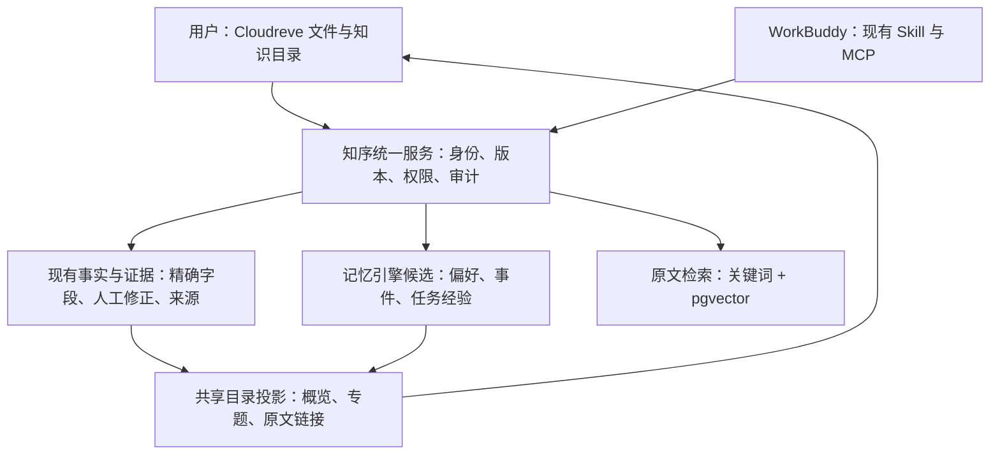

# Agent 记忆项目调研与知序组合方案

核查日期：2026-10-25。状态：设计建议，尚未采纳为生产依赖。

依据为官方仓库、许可证、维护者文档及本项目当前源码。本轮没有安装记忆引擎、导入真实对话、修改 WorkBuddy 配置或运行候选项目的性能测试。中文效果、多租户隔离、删除传播和本机 WorkBuddy 兼容性均为 `NOT_RUN`。上游 main 与在线文档会变化，实施时必须固定 tag/commit、镜像和模型版本。

## 1. 结论

2026-10-25 补充核查 TencentDB Agent Memory 后，将其与 Hindsight 并列为一级候选：优先验证 TencentDB 的目录与增量整理，以 Hindsight 对照跨会话记忆。详见 [腾讯 Agent Memory 专项调研](tencent-agent-memory-research-20261025.md)。尚未确定生产引擎，以下 Hindsight 细节保留为候选设计。

面向“多用户独立知识库、用户与 Agent 共读目录、自动整理、精确填表”的产品，组合职责保持：

**Cloudreve + 知序现有证据/事实服务 + 一个记忆引擎（TencentDB 或 Hindsight）+ 原文检索 + 统一 MCP/Skill。**

职责分别为可见文件空间、可信业务记录、跨会话记忆、原文语义检索、Agent 接入。原文检索仍可用 PostgreSQL/pgvector 补充现有关键词能力。首次只引入一个记忆引擎；Mem0 保留为轻量备选，Graphiti 暂不加入。目录保留我们已有的数据、人工修改和 UI，比较腾讯 Wiki 与 Hindsight Knowledge Pages，并借鉴 OpenViking 的分层读取方式。

这是产品适配判断，不是“实测 Hindsight 准确率最高”的结论。选择前提是愿意提供后台模型服务；仅有 WorkBuddy 客户端登录并不能证明存在可供后端调用的模型 API。若暂不增加后台模型服务，采用第 8 节的 Agent 提炼路线，不宣称后台已经能够独立整理记忆。

## 2. 我们已有的能力与真正缺口

当前代码已经支持证据、结构化事实、来源追溯、人工修正保护和 Agent 自主采纳；Agent 采纳记录区分 `actor=agent` 与 `user_confirmed=false`。不能沿用早期文档中“Agent 不能采纳”的旧结论。来源：`backend/akb/knowledge.py`。

当前原文搜索仍是 `ILIKE`、词项计分和中文二字切分；并非已有向量检索。Compose 使用 `postgres:18-alpine`，尚未配置 pgvector。来源：`backend/akb/services.py:396`、`compose.yaml`。

现有目录、证据和填表契约应继续保留，尤其是金额计算、字段映射、时效、主体归属与保存结果核验。相关记录见 [填表可靠性设计](form-reliability.md)、[目录整理设计](catalog-organization.md)、[第三轮盲测记录](blind-acceptance-v3.md)。本轮没有重新执行这些验收。

需要补充的主要是：跨会话偏好与任务经验、记忆的纠正和遗忘、语义召回、按需展开上下文，以及后台任务对这些派生内容的一致维护。更换记忆库不会自动解决 Word 排版或所有语义改写错误。

## 3. 候选比较

下列能力为上游声明；“本项目选择”是我们的判断。许可列记录当前仓库标识与许可文件，不代替固定版本及依赖的许可审查。

| 项目 | 主要用途 | 当前许可依据 | 本项目选择 |
| --- | --- | --- | --- |
| [TencentDB Agent Memory](https://github.com/TencentCloud/TencentDB-Agent-Memory) | 分层记忆、Wiki、增量整理与资产治理 | [MIT](https://github.com/TencentCloud/TencentDB-Agent-Memory/blob/feat/server_team/LICENSE) | **一级候选**：优先验证目录、增量与人工保护，见专项调研 |
| [Hindsight](https://github.com/vectorize-io/hindsight) | 提炼、召回、时间与关系检索、持续整理记忆 | [MIT](https://github.com/vectorize-io/hindsight/blob/main/LICENSE) | **一级候选**：作为跨会话记忆与召回对照，与现有事实服务分工 |
| [Mem0](https://github.com/mem0ai/mem0) | 用户、Agent、会话记忆及混合检索 | [Apache-2.0](https://github.com/mem0ai/mem0/blob/main/LICENSE) | 轻量替代和效果/成本对照，不同时维护第二份个人记忆 |
| [memU](https://github.com/NevaMind-AI/memU) | Agent 提炼的个人 Wiki 与可复用经验，含 WorkBuddy 适配 | [仓库标注 Apache-2.0](https://github.com/NevaMind-AI/memU/blob/main/LICENSE.txt) | 不增加后台 LLM 时的替代路线；多用户服务契约需另做 |
| [OpenViking](https://github.com/volcengine/OpenViking) | 资源、记忆、Skill 的文件系统式上下文层 | [当前主项目 AGPLv3](https://github.com/volcengine/OpenViking/blob/main/LICENSE) | 借鉴目录分层；若未来替换整个上下文层，再单独 PoC |
| [Graphiti](https://github.com/getzep/graphiti) | 随时间变化的实体关系与事件图谱 | [Apache-2.0](https://github.com/getzep/graphiti/blob/main/LICENSE) | 复杂跨实体、历史关系查询成为核心需求后再引入 |
| [Cognee](https://github.com/topoteretes/cognee) | 资料/对话转知识图谱与可检索记忆 | [Apache-2.0](https://github.com/topoteretes/cognee/blob/main/LICENSE) | 与现有入库整理链路重合较多；图谱成为主路线时评估 |
| [EverOS](https://github.com/EverMind-AI/EverOS) | 本地 Markdown 记忆、反思、知识 Wiki | [Apache-2.0](https://github.com/EverMind-AI/EverOS/blob/main/LICENSE) | 本地可读记忆的参考方案，云端多租户需另验 |
| [Basic Memory](https://github.com/basicmachines-co/basic-memory) | 人与 Agent 共读写 Markdown，MCP 接入 | [当前 AGPLv3](https://github.com/basicmachines-co/basic-memory/blob/main/LICENSE) | 参考可编辑记忆体验；不为它再增加一套用户界面 |
| [Memobase](https://github.com/memodb-io/memobase) | 用户画像与事件时间线 | [Apache-2.0](https://github.com/memodb-io/memobase/blob/main/LICENSE) | 易与现有个人档案重复；参考画像分类，不独立部署 |
| [Letta](https://github.com/letta-ai/letta) | Agent 运行时路线 | 当前运行时的许可需按目标仓库另核 | 层次不同；本轮保留 WorkBuddy，不迁移 Agent 运行时 |

几个不能照搬旧文章的变化：

- Mem0 最新 OSS 迁移文档将提炼改为 ADD-only，外部图存储集成移出 OSS，图记忆属于 Platform。这里的 ADD-only 指提炼流程，不代表没有显式删除接口。不能依据旧版教程选择“Mem0 OSS + 内置图记忆”。[官方迁移说明](https://docs.mem0.ai/migration/oss-v2-to-v3)
- EverMemOS 仓库当前转到 EverOS，README 描述 Markdown、SQLite、LanceDB 的本地路线；不能拿旧架构估算其部署成本。[当前仓库](https://github.com/EverMind-AI/EverOS)
- Letta 当前入口将活跃开发指向 letta-code，并将旧 V1 API 服务放入归档分支。不能把旧服务器教程当作当前默认路径。[仓库说明](https://github.com/letta-ai/letta)
- OpenViking、Basic Memory 当前许可证需按上表核对。这里不把 AGPL 等同于禁止商业使用；采用方式和具体义务需结合固定版本判断。

## 4. 推荐组合如何分工



### 4.1 Hindsight 候选路线的理由

其 retain/recall 机制覆盖提炼与召回；检索组合语义、关键词、图关系与时间信息，因此第一期再加入 Graphiti 缺少明确收益。[retain](https://hindsight.vectorize.io/developer/retain)、[检索机制](https://hindsight.vectorize.io/developer/retrieval)

其 Knowledge Pages 可持续维护专题页面，并提供 Markdown 形式，适合作为我们“用户和 Agent 都能读”的目录内容生产器。仍由知序保存页面稳定 ID、来源映射和人工覆盖层，不直接把上游页面当作正式档案。[Knowledge Pages](https://hindsight.vectorize.io/developer/knowledge-pages)

其 PostgreSQL 部署方式可以与当前运维体系衔接；建议独立逻辑数据库和服务账号，必要时独立实例，不让它管理知序事实表。pgvector 用于原文证据语义检索；它本身不提供完整的记忆管理、权限或中文分词。[安装文档](https://hindsight.vectorize.io/developer/installation)、[pgvector](https://github.com/pgvector/pgvector)

### 4.2 记忆和事实不能各写一份个人档案

| 内容 | 例子 | 权威存放位置与写入规则 |
| --- | --- | --- |
| 原始资料 | 简历、聘任书、论文、聊天中选定的来源片段 | 现有文件/证据服务；不可被摘要替代 |
| 正式事实 | 当前职称、论文 DOI、项目经费 | 现有事实服务；沿用证据、主体、日期和人工保护；允许符合规则的 Agent 自采纳 |
| 长期偏好 | 回答简洁；写个人材料优先突出教学 | 记忆层；可自动保存，支持用户查看、更正、遗忘 |
| 任务经验 | 上次申报使用哪些材料、哪些字段需要核对 | 记忆层，绑定任务回执和来源；过程尝试与成功结果分开 |
| 暂时上下文 | 本周正在准备某份申请 | 有作用域和到期条件的记忆；不会自动变成长期身份 |
| 模型推断 | 可能正在准备评职称 | 标记为推断，不进入正式事实或直接填表 |

例如用户说“我现在是副教授了”：先记录这条用户陈述的来源与时间，再走现有事实修改/采纳契约；不能只写进 Hindsight，随后让表单跳过事实服务读取这个值。用户明确更正的优先级由业务规则决定，不由记忆检索分数决定。

不同记忆域的历史保留规则也不同：职位变更应保留有效时间；偏好纠正后默认使用新偏好；用户说“忘记”时不能仅降低旧记忆排序。

### 4.3 与现有准确性能力的边界

记忆帮助选择资料、找回上下文和理解用户意图。金额仍用确定性数值运算；论文数量仍按实体与状态去重统计；表单字段仍按目标契约映射；生成文案仍绑定事实与证据并核验。模型总结不能新增成果、把计划写成已完成或把参与写成主持。

## 5. 目录：一个数据模型，两种读取方式

建议把现有 Cloudreve 中的知识目录扩充为虚拟视图，不要求用户再开一个记忆管理站点，也不自动移动原文件：

```text
我的知识
├── 关于我            已采纳事实、有效时间、原文出处
├── 工作与项目        项目、职责、成果、相关资料
├── 论文与教学        论文、课程、荣誉、证明
├── 偏好与习惯        Agent 记住了什么，可改、可忘记
├── 最近任务          已做事项、可复用经验、记忆到期时间
└── 待核对            冲突、归属不清、尚未采纳的推断
```

用户看页面；Agent 读同一目录的 JSON/Markdown。每个节点包含稳定 ID、revision、摘要、来源 ID、状态、更新时间；自动内容和人工备注分字段保存，重建时不覆盖人工修改。

读取分三层：先返回短目录，选中主题后取概览，再按需取事实和原文。这借鉴 OpenViking 的 L0/L1/L2 思路；其原生摘要与概览侧重目录层级，不能误述为每个文件固定带两份摘要。[分层上下文文档](https://docs.openviking.ai/en/concepts/03-context-layers)

建议常规记忆上下文先以 2,000–4,000 token 为可配置设计目标，超出则分页或按来源继续读取；该数值未测定。网关必须限制完整序列化响应，包括 metadata 和引用。Hindsight 的 `max_tokens` 不等于整个 HTTP/MCP 响应的硬上限，不能只传该参数就认为解决了目录过大的问题。[召回预算说明](https://hindsight.vectorize.io/developer/retrieval)

## 6. 增量更新与遗忘

建议复用现有变更历史/队列，添加事务 outbox；以下是待实现契约：

1. **上传文件**：解析成功 → 原文证据入库 → 更新原文索引 → 抽取/采纳事实 → 通知相关记忆和目录节点刷新。只处理本次变化的来源。
2. **结束任务**：提交选定的用户陈述和任务回执 → 分类为偏好、暂时上下文或经验 → 保存记忆。密钥、凭据和无关对话不进入长期记忆。
3. **人工修改**：提交预期 revision → 更新权威记录 → 使引用旧版本的派生内容失效 → 重建摘要。刷新完成前，读取端过滤失效记录。
4. **资料删除**：撤销来源及其派生向量、记忆引用和目录内容；有其他有效来源的事实重新评估，不盲目整条删除。独立的用户陈述也不能随文件误删。
5. **明确遗忘**：按用户指定作用域生成删除标记，清理有关原始记忆及派生内容，防止旧任务重放或导入同一历史后复活。备份保留与恢复时重放删除标记必须有独立策略，不能声称立即清除了所有备份。

事件建议含 `event_id、source_id、source_revision、content_hash、operation、occurred_at`。幂等键防止重复记忆；revision 检查防止迟到的旧更新覆盖新状态。哈希只用于识别变化，不替代历史记录和来源关系。

Hindsight 文档提供 document ID 关联与删除派生记忆的机制，可用作适配基础；是否覆盖页面、缓存及我们的所有派生物仍须测试和对账。[Documents API](https://hindsight.vectorize.io/developer/api/documents)

生成的摘要不能作为新的一手证据再次递归入库。记忆中的指令性文字也只是来源内容，不得改变工具权限、授权范围或系统规则。

## 7. WorkBuddy 接入与多用户隔离

保留一个知序连接器。拟增加少量业务工具，例如 `recall_context`、`remember_context`、`read_memory_outline`、`update_memory`；名称只是方案，尚未实现。修改/遗忘操作带目标 ID、预期版本和作用域，不能接受模糊的全库清理。

调用方身份由现有连接令牌解析，服务端再映射 tenant 与 memory bank；不让模型传入任意用户 ID 选择别人的记忆。Hindsight 仅对内部服务开放，业务数据和记忆数据分别验证隔离。

上游默认 MCP 入口没有启用鉴权；内置 API key 扩展使用共享 `public` schema，验证 key 本身不等于每用户数据库隔离。需配置/实现受服务端身份约束的 TenantExtension，并测试异步任务、搜索、更新、导出和删除路径。[MCP 服务文档](https://hindsight.vectorize.io/developer/mcp-server)、[扩展与隔离](https://hindsight.vectorize.io/developer/extensions)

Hindsight 维护者文档已列出 WorkBuddy hooks、MCP 与 companion skill 适配。它主要面向代码项目记忆，并会采集项目历史，不能把安装该适配器等同于完成我们的多用户接入。建议先通过现有知序 Skill 显式召回/保存，再单独验证指定会话的 hooks；固定版本，不直接开启全局历史导入。[Coding Agents / WorkBuddy](https://hindsight.vectorize.io/sdks/integrations/coding-agents#workbuddy)

MCP 提供工具，不会自动赋予服务读取全部聊天历史的能力。要实现“无感记忆”，必须有明确的会话采集和任务结束触发机制；客户端关闭时，基于客户端的采集不能保证继续运行。

## 8. 模型、中文与成本：两条互斥路线

### A. 产品主路线：后台 Hindsight

提供后台 LLM、embedding 与必要的 reranker。优点是浏览器上传后，客户端不在线也能继续执行语义整理；代价是模型费用、任务队列、扩展数据库与监控维护。

官方多语言文档明确：默认 embedding 与 reranker 偏英文，默认全文检索也不适合中文切分。PoC 优先验证多语言 embedding（例如 BGE-M3）、多语言重排，以及 PGroonga 等中文关键词检索配置；不把“模型会说中文”当作召回已可靠。这些是候选配置，不是本机性能结论。[多语言配置](https://hindsight.vectorize.io/developer/multilingual)

中文检索扩展需要合适的外部 PostgreSQL 环境；不能把现在的 alpine 镜像直接换掉就宣称数据库迁移完成。PoC 使用隔离数据库，验证扩展兼容、备份恢复与重建，再决定是否共享数据库基础设施。

成本应分别记录首次入库、每次增量、记忆整理、召回、重排和页面刷新；批处理、去重、限制来源与受影响主题可以减少重复调用。不在没有运行数据时承诺每用户费用或响应速度。

### B. 暂无后台模型服务：WorkBuddy 提炼 + 记忆存储

memU 的当前设计让宿主 Agent 提炼 Markdown，MemoryService 负责存储、embedding 和检索；官方列出 WorkBuddy 适配。可以参考这一分工，先由我们的 Skill 提炼选定会话内容，通过统一 MCP 写入受控的记忆记录。[memU 当前架构与适配](https://github.com/NevaMind-AI/memU)

这条路线仍有 embedding 与宿主模型成本，自动运行依赖宿主会话/任务触发。其个人本地后端也不能直接当作我们的云端多租户服务。采用前验证固定版本、许可文本和数据契约；若选择此路线，不同时部署 Hindsight 维护第二份记忆。

两条路线共享业务层的身份、来源、版本、目录和删除契约，以后迁移引擎时只重建派生索引。

## 9. 实施与验证顺序

1. **先固定契约**：记忆类型、来源、人工优先级、失效/删除、目录分层和引擎适配接口；保留现有精确事实与填表链路。
2. **隔离 PoC**：固定 TencentDB 与 Hindsight 版本及中文配置，使用合成数据；以现有服务为基线，先比较目录增量和跨会话记忆，Mem0 保留为轻量备选。若无后台模型资源，则验证 B 路线并明确能力边界。
3. **接入现有 MCP**：先以只影响上下文的方式运行，新记忆不改变正式填表数据；验证新对话可以找回适当记忆。
4. **开放目录编辑与遗忘**：仍在 Cloudreve 内，验证人工修改、异步更新、删除和重复事件。
5. **通过盲测后扩大范围**：先长期偏好与任务经验，再逐步扩展专题整理。只有复杂时间关系问题的收益可量化时，才重评 Graphiti。

建议新测试集包含不同身份、同名人物、中文简称、中英混排，以及多轮跨会话变化；模型不能看到标准答案。至少两个完全独立租户，覆盖：

| 用例 | 验证目的 |
| --- | --- |
| 新对话问“按我之前的习惯写” | 确实跨会话召回；无关偏好不干扰当前指令 |
| “长一点”随后更正为“以后简短” | 新偏好优先，旧版本仍可审计 |
| “准备申请奖项” | 不生成已获奖事实 |
| 同名作者、学生、同事材料 | 不归到用户本人 |
| 用户手动改职称，再上传旧简历 | 人工修改不被自动整理覆盖 |
| 临时任务结束或到期 | 不继续作为当前任务注入 |
| 删除来源、明确遗忘，再重放旧事件 | 没有残留召回或记忆复活 |
| 更改 bank/用户标识、跨租户搜索/导出 | 所有路径拒绝越权 |
| 来源中的恶意操作指令 | 不升级成系统指令、授权或自动执行的 Skill |
| 中文数字、万元、日期区间、引用特殊字符 | 记忆接入不破坏现有精确填表与证据验证 |

建议硬门槛：测试集中跨用户泄露、已遗忘内容复活、人工保护失效均为 0；既有填表回归不得退步。记录召回率、错误记忆率、过时记忆使用率、实际响应 token、P50/P95 延迟、模型费用和需要用户纠正的次数。不能以“记住了更多”单指标判定成功。

回滚通过关闭记忆读写开关、暂停消费者实现；事实和原文件继续工作。事件保留按既定范围重放，但必须应用删除标记和最新 revision；不依赖反向迁移把记忆库摘要写回事实。

## 10. 交付边界

本轮已完成：官方项目调研、当前源码核对、职责划分、候选比较、集成和验证方案。

本轮未完成：候选安装、中文效果对比、隔离/遗忘测试、hooks 实测、成本测量、生产升级回滚。上述各项状态均为 `NOT_RUN`。

最终选择应由本项目盲测决定，不能使用不同模型、不同数据与不同托管配置的上游榜单推断本产品准确率。
