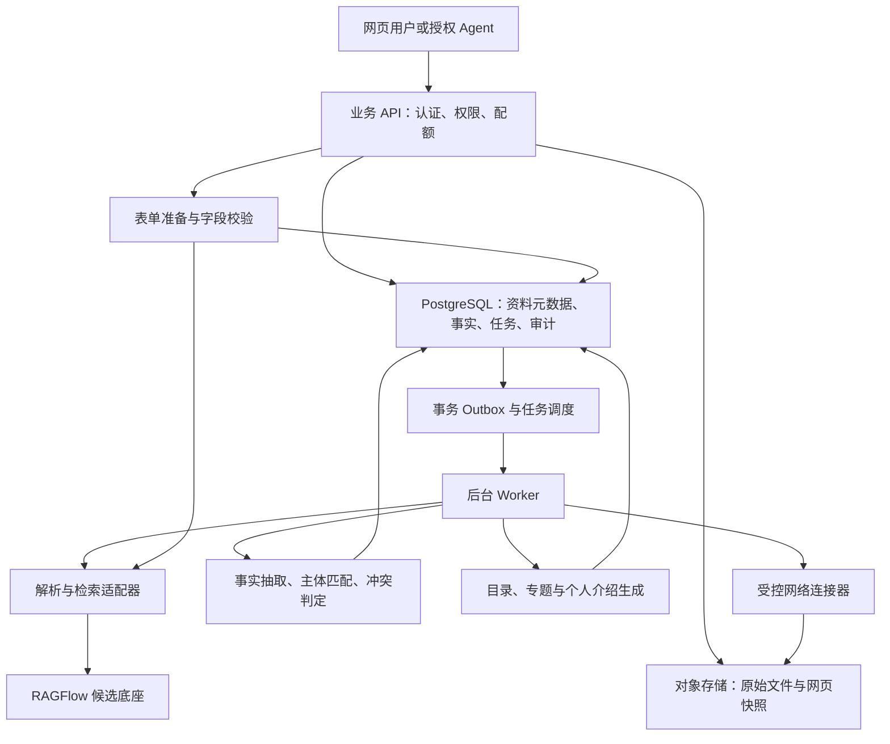

> 2026-10-25：当前实现已切换为腾讯 Memory + WorkBuddy 外部 Agent 模式。本文相关旧设计为历史记录，以 [当前切换方案](tencent-memory-cutover.md) 为准。

# Agent 个人知识库技术方案

版本：v0.1

日期：2026-10-16（Asia/Shanghai）

状态：目标架构设计稿；已有本地开发基线，当前范围和验证见 [实施记录](implementation-status.md)

适用范围：多用户产品，每个用户拥有独立的个人知识库

## 1. 目标与设计依据

用户希望把分散文件集中保存，系统处理后支持知识提取，并主动整理目录、个人介绍、工作信息和教师论文等资料；Agent 可以利用这些内容填写表单，也能检索网络并将补充资料下载、写入个人知识库。

关于用户组织方式，已确认“多用户、每人独立知识库”。2026-10-17 补充确认：WorkBuddy 作为 Agent 入口，通过 MCP 使用知识库；不采用后端调用其云任务 API 的路线。以下仍为工程建议：

- 第一版采用服务端部署、网页入口，以个人知识库为隔离边界。
- 通用个人资料为基础模型，教师科研成果作为第一个扩展模板，产品不限定为教师工具。
- 第一版优先自有表单与标准字段接口；第三方网页填写在后续里程碑接入。
- 网络补全在用户开启规则后主动执行，最终对外提交单独控制。
- 用户规模、预算、模型供应商、数据驻留地域与现有登录系统尚未确认。先以可替换接口设计，不默认接入既有产品。

核心原则：原始资料保存证据，结构化事实支持准确办事，整理页面方便理解。三者独立存储、通过来源关系关联。

2026-10-17 已落地目录基线：稳定目录及人工覆盖、事件触发的存量/增量整理、网页与 MCP 共用 JSON/Markdown。后台采用可复核的规则与原文摘录，语义整理仍由 WorkBuddy 按任务执行，未接后台模型。详见 [实现与验收](catalog-organization.md)；以下更广的架构仍为目标设计。

特别区分：文件所有者不等于文件中描述的人；论文收藏者不等于作者；网站出现同名人物不代表属于该用户；资料上传时间不等于事实生效时间。

## 2. 产品范围与首轮实现边界

本稿的 v0.1 是文档版本，不是已发布的软件版本。完整目标包含主动补全与表单填写；首轮产品按 P1 基础闭环、P2 主动补全逐步交付，P3 再增加第三方网页执行，不将后续阶段误报为已经实现。

| 能力 | 首轮产品规划（P1–P2） | 后续扩展 |
| --- | --- | --- |
| 资料输入 | PDF、DOCX、XLSX、PPTX、TXT/Markdown、PNG/JPEG、网页链接；实际可用以样本验证为准 | 音视频、邮件、网盘同步、旧版二进制 Office 格式 |
| 整理 | 文件分类、虚拟目录、摘要、个人档案、专题页面、变更记录 | 更复杂的关系图谱与跨专题推理 |
| 提取 | 带原文定位的问答、结构化字段查询、论文列表与统计 | 更多行业档案模板 |
| 填表 | 自有表单或显式 JSON Schema，生成有依据的填写草稿 | 浏览器扩展、特定第三方站点适配 |
| 网络补全 | 用户指定来源及学术 API，受规则约束的主动入库 | 更多数据源、复杂订阅规则 |
| 数据管理 | 查看、更正、导出、删除、处理进度和费用记录 | 组织共享与分级协作 |

“所有文件放在一起”首先意味着统一管理入口，不承诺所有格式都能理解。可存储但不支持解析、加密、损坏、超限和部分解析等状态必须明确展示。可执行文件、宏和嵌入脚本不执行；图片里的文字也不能默认识别正确。

第一版不包含跨用户共享、任意网站无人值守提交、自动购买付费资料、自动修改第三方个人主页、通用图数据库和自动训练个人模型。

## 3. 产品信息结构

- **我的资料**：原文件、来源、版本、处理状态、证据预览。允许用户按原目录查看。
- **关于我**：个人信息、教育、任职、项目、成果及生成的不同长度介绍；逐项显示依据和状态。
- **专题知识**：按主题组织收藏和研究资料，内容不要求与本人身份有关。
- **待确认事项**：同名作者、冲突职称、缺失日期、可疑解析和网络候选资料。
- **任务记录**：整理、补全、填表的进度、变更、费用、失败原因和撤销入口。

目录是可修正的虚拟视图，同一份资料可以关联多个主题；自动分类不移动或改写原始文件。用户自己建立的分类和页面编辑有独立记录，重新生成时必须保留或显式提示冲突。

## 4. 总体架构

采用模块化业务服务加后台 Worker，初期不拆成大量微服务。网页客户端只访问业务 API；检索引擎、数据库、对象存储和模型凭据不直接暴露给客户端。

### 4.1 推荐组件与责任

| 组件 | 建议选型 | 自己必须承担的责任 |
| --- | --- | --- |
| Web | TypeScript + React；具体构建框架实现前锁定 | 资料、档案、证据、差异和填表预览 |
| 业务 API / Worker | Python + FastAPI，业务模块复用 | 权限、任务、事实、补全规则、表单口径 |
| 业务数据库 | PostgreSQL，迁移工具使用 Alembic | 原始资料元数据、事实版本、来源关系、任务状态 |
| 文件存储 | S3 兼容对象存储，具体服务待部署条件确定 | 文件保留、访问控制、配额、清理和恢复 |
| 文档处理与检索 | RAGFlow，固定版本完成 PoC | 身份映射、输入输出适配、引用和删除一致性 |
| 后台执行 | PostgreSQL 事务 Outbox + 可租约领取的任务表；后续按吞吐量评估消息队列 | 幂等、租约、重试、限流、取消与失效判断 |
| 有状态 Agent 流程 | 需要多步检索和暂停恢复时使用 LangGraph | 业务状态仍以数据库为准，工具副作用自行幂等 |
| 模型网关 | 统一封装 LLM、Embedding、Reranker | 模型版本、预算、超时、结构化输出校验与数据策略 |

RAGFlow 的内部依赖使用所选发行版本支持的配置，与业务 PostgreSQL 分开管理。不可假设它能直接共用业务数据库。引入 RAGFlow 后，第一版不再另外部署一套 Qdrant、Neo4j 或用户记忆平台。

### 4.2 为什么保留自研业务层

RAGFlow 可以提供多格式处理、检索和知识编译，但个人身份归属、任职有效时间、用户修正优先级、论文统计和对外披露授权是本产品的业务规则，不能交给通用聊天记忆隐式决定。

RAGFlow 的知识编译生成结果可以用于目录或专题草稿。其自身结果不是个人事实的最终依据；改变模板后的重算也应由本产品任务系统显式触发。[知识编译说明](https://ragflow.io/docs/v1.0.0-rc2/knowledge_compilation/overview)、[重算说明](https://ragflow.io/docs/knowledge_compilation/faq)

## 5. 数据模型

### 5.1 三层数据与身份边界

1. 原始层：文件、网页快照、用户明确填写的声明，保留内容版本。
2. 事实层：抽取声明、主体关系、冲突及采纳决定，形成可查询的档案。
3. 派生层：目录、摘要、简介、专题页面和表单草稿，可由前两层重新生成。

应用用户通过内部 `user_id` 标识。接入外部登录时用提供方的稳定身份，例如 `(issuer, subject)`，不以姓名或邮箱自动合并身份。每个用户初期创建一个个人 `tenant_id`；知识库中的其他人物使用独立 `entity_id`。

### 5.2 主要逻辑表

以下是逻辑设计，不是已执行的 SQL 迁移。

| 表/对象 | 主要字段与作用 |
| --- | --- |
| `users / identities / tenants` | 用户、外部身份与个人租户；租户绑定由服务端确定 |
| `sources` | `tenant_id, source_id, kind, owner_user_id, origin_url, status, revision, active_generation_id, revoked_at`；逻辑资料 |
| `source_versions` | `source_id, version_id, object_key, sha256, fetched_at, media_type, origin_kind`；不可变原始版本 |
| `processing_runs` | `version_id, generation_id, parser_version, model_version, schema_version, policy_revision, stage, coverage_status` |
| `evidence_blocks` | `block_id, version_id, generation_id, locator, text_hash, text_object_ref`；可定位证据 |
| `entities / entity_aliases` | 人物、机构、论文、项目等；别名和外部标识不自动证明同一身份 |
| `claims` | `claim_id, subject_entity_id, predicate, typed_value, valid_from, valid_to, observed_at, revision` |
| `claim_evidence` | 声明与证据的多对多关系，记录支持、反对或仅提及；包含来源生成批次 |
| `claim_decisions` | 采纳、驳回、争议、人工修正、判定依据及操作者；追加记录 |
| `profile_projection` | 当前可用的个人档案投影，包含快照版本及源声明 ID |
| `employments / educations` | 带时间范围的任职、教育投影，服务确定性查询 |
| `publications / publication_versions / authorships` | 论文实体、版本及作者关系；作者次序、共同第一、通讯身份允许未知 |
| `collections / collection_items` | 虚拟目录、主题及成员关系；保留人工固定关系 |
| `knowledge_pages / page_revisions / dependencies` | 生成页面、修订、人工内容与到证据/声明的依赖关系 |
| `enrichment_rules / enrichment_candidates` | 补全范围、周期、预算、候选来源、身份判定与处理结果 |
| `form_drafts / field_answers` | 目标表单、快照版本、字段值、依据、状态及用户修改 |
| `outbox_events / jobs / audit_events` | 可靠调度、执行租约和操作审计 |

所有租户业务对象携带 `tenant_id`；父子外键使用包含租户的复合约束，防止跨租户引用。正文可放对象存储，数据库保留定位和哈希。不能用大段自由文本替代需要筛选、排序、计数的业务字段。

### 5.3 声明状态与可信依据分开

`decision_status`：`candidate / accepted / disputed / superseded / rejected`。

`verification_basis`：`user_asserted / user_confirmed / source_supported / inferred`。`accepted` 表示满足当前使用策略，不等于客观事实已被外部认证；用户自述也不等于第三方证明。

- 来自用户资料、主体匹配明确且无冲突的低风险字段，可以按规则自动采纳，标记 `source_supported`。
- 模型推断保留为候选，不进入精确填表默认集合。
- 姓名相同、作者顺序不清或任职时间冲突，不通过模型自报置信度直接采纳。
- 用户明确修正以独立声明和决定保存；后台任务不能覆盖该决定。
- 业务资格、证件、作者身份等字段采用更严格的字段策略；填写时展示其真实依据。

时间采用“事实有效时间”和“系统获知时间”双维度。例如旧简历中的副教授与新聘任文件中的教授可以同时为真；缺少生效日期时不得仅按上传先后确定现任职称。

精确日期的有效区间采用左闭右开；只有年份或月份时保留日期精度，不伪造具体日。未知起止时间与确认持续有效分开表达。系统事件存 UTC，用户展示和统计截止日按显式时区解释。

### 5.4 论文与资料的关系

每个用户的收藏记录与论文实体关联；只有明确建立 `authorship` 后，论文才属于其成果列表。论文 DOI、预印本标识和不同全文版本分别记录。按 DOI 去重时仍保留版本；无 DOI 时标题和作者相似度只用于提出合并候选。

外部作者 ID 或 ORCID 是匹配信号，需要记录来自原始作者署名还是聚合作者档案。共同第一作者、通讯作者、正式出版日期缺失时保持未知，不从作者数量或排名猜测。

### 5.5 证据与派生内容

PDF 使用页码和区域；XLSX 使用工作表和单元格范围；DOCX 使用段落或表格位置；网页使用快照版本与片段定位。定位能力按格式验证，不伪造统一页码。

应用自己的 `block_id` 不等于引擎 chunk ID；保存映射和生成批次。重新解析产生新批次，旧引用保留在其版本上，不暗中指向新内容。

所有生成内容标记 `origin_kind=generated`，只作为导航或缓存；不得被再次抽取为新的独立证据。用户修改生成页面时，需明确是修改文案还是声明事实，后者进入事实决策流程。

本系统导出时保留来源 manifest；再次导入可用 manifest 和已知哈希识别派生内容。对于外部改写、去除元数据的文本，不能保证识别其是否由 AI 生成，应保留“来源未核实”，不能声称存在可靠的通用生成内容检测器。

## 6. 文件入库与增量整理

### 6.1 状态和发布

资料生命周期与处理阶段分开。处理阶段包含：

`uploaded → validating → parsing → extracting/indexing → organizing → ready`。

并行分支分别记录状态；可出现 `partial / failed / unsupported / password_required / cancelled`。页面显示哪些内容已可用、哪些失败，不把一次上传成功呈现为入库完成。

每次处理创建独立 `generation_id`，状态为 `building / active / stale / revoked`。新批次完成校验后，数据库事务切换 `active_generation_id` 和有效投影；同一源的当前视图只选中一个批次。引擎中尚未发布或已撤销的内容，不进入检索结果及模型上下文。

允许部分解析内容用于注明覆盖范围的资料问答，但必须记录未处理页或区域；部分结果不能作为完整名单、全量计数或无缺失的个人档案发布。

旧版本在替换处理中是否继续可读由操作决定：普通重算可保留旧有效批次并标记更新时间；用户撤回、敏感内容删除或明确纠错时应立即阻断旧结果。

### 6.2 入库步骤

1. 服务端创建上传记录与受限上传凭据；客户端只上传到指定对象。
2. 服务端确认文件实际存在，核验大小、类型和内容哈希；租户内检查重复。
3. 沙箱化解析，生成文本、结构、表格和定位；不执行宏、公式代码或文件内脚本。
4. 抽取文档类型、主题、实体、关系和带证据的候选声明。
5. 做主体匹配、规范化、冲突检查和字段级采纳判定。
6. 写入检索引擎的新批次，核验返回结果只能关联本租户资料。
7. 更新受影响的事实投影、目录和知识页面。
8. 发布可用批次，记录处理用量、阶段耗时、失败及需要确认的事项。

批量上传需要按租户公平调度，避免单个用户的大文件占满解析资源。重复文件只在本租户提示，不暴露其他用户是否拥有同一资料。

### 6.3 幂等、重试和并发

- 创建资料版本与 Outbox 事件在同一数据库事务提交。
- 任务幂等键包含 `tenant_id + version_id + generation_id + stage`；模型、解析器或 schema 改变通过新批次表达。
- Worker 用租约领取任务，记录递增的 fencing token；过期 Worker 不得提交状态或发布结果。
- 调用外部引擎前记录意图，超时后先对账，不盲目重复创建；无幂等 API 时用引擎映射和清理任务收敛。
- 结果提交时重新检查资料 revision、删除标记、用户决定 revision 和授权策略 revision。
- 采用至少一次投递和幂等业务写入，不承诺跨数据库与外部引擎的 exactly-once。
- LangGraph checkpoint 用于恢复推理步骤；数据库任务状态和副作用账本负责判断某项动作是否已完成。

### 6.4 删除与撤回

删除请求先在业务层提交撤销标记并增加权限/资料 revision，使后续检索、引用读取、下载和生成结果发布失败。请求完成前已开始的查询也必须在返回结果前重新检查。

后台清理依次覆盖索引、解析结果、页面依赖、缓存、事实支持关系、文件版本及执行临时文件。事实有其他有效证据时重新判定；仅有被删证据时移出可用集合。已有表单草稿标记需要刷新。

保存的回答摘录、对话引用和 Agent checkpoint 同样进入依赖失效与清理范围。已经下载到用户设备或提交到第三方的副本无法通过本系统删除自动收回；删除界面区分受本系统控制的数据范围。

清理任务失败可重试，API 区分“已撤回访问”和“物理清理完成”。备份的保留与最终清除窗口待运营策略确定；恢复备份后先重放撤销记录，避免已删除资料重新上线。

第一版私有原件经鉴权下载代理提供，便于撤销访问。后续若改为直接签名下载 URL，必须明确 URL 到期前的残留访问窗口，不能声称立即撤销。

## 7. 检索和知识提取

查询先识别所需数据类型，再选择执行方式：

- 精确个人字段：读取事实投影，检查时效、争议和使用策略。
- 列表、筛选、统计：执行受约束的结构化查询，不以检索 top-k 充当完整集合。
- 资料解释与总结：关键词加语义检索、必要时重排，依据原始证据生成回答。
- 跨资料问题：允许有限轮次补充检索，设轮次、时间和 token 上限。

“近五年第一作者论文”必须定义截止日、滚动五年或自然年、共同第一作者是否计入、发表状态和版本去重口径。口径进入查询计划与结果说明。若用户尚未确定必要口径，先返回候选结果和需确认的一个关键条件。

统计返回 `as_of`、资料范围、处理覆盖状态、未解决候选数量及快照版本。“已入库且确认的论文有 N 篇”不等于“此人全部论文有 N 篇”。还有解析中、解析失败、身份待确认或关键日期缺失的相关资料时，结果标记不完整，不把部分数量静默填入要求完整总数的字段。

回答返回证据定位和来源版本；聚合结果返回被计入的记录及排除理由。资料不足时明确未知。生成摘要可帮助选择资料，但最终事实性结论回到原始证据或明确的用户声明。

## 8. RAGFlow 适配边界

下面定义本产品的适配器契约，不代表上游提供同名 API：

| 操作 | 契约 |
| --- | --- |
| `ingest` | 输入已授权的源版本、处理配置和批次，返回可追踪的引擎任务映射 |
| `get_status` | 返回阶段、失败类型、解析覆盖范围，不把 HTTP 成功当作处理完成 |
| `search` | 仅允许服务端解析出的本租户数据集与有效批次；返回带原文定位的证据 |
| `read_evidence` | 获取指定版本的证据；映射失败返回明确错误，不生成替代引用 |
| `delete_generation` | 可重复执行，提供删除对账结果 |
| `capabilities` | 说明格式、定位、过滤、导出和版本能力 |

优先使用官方公开 API，不直接依赖内部数据库。必须在 PoC 验证解析结构与定位是否能充分获取、过滤能否发生在召回前、删除是否可对账、账号/数据集能否安全自动管理。[官方 HTTP API](https://ragflow.io/docs/http_api_reference)

首选每个个人租户映射独立引擎身份和私有数据集，凭据只存在服务端。若固定版本无法自动管理这些身份，PoC 可有限预配置；正式版本不能把一个共享超级 API Key 加客户端传入的数据集 ID 当成隔离方案。

如果考虑共享引擎身份，必须增加仅接受服务端租户上下文的隔离网关，验证所有读取、列举、检索、删除、编译和回调路径的权限，形成单独决策记录。未通过前不开放外部多租户使用。

引擎结果进入重排器或 LLM 前再次校验租户、版本和撤回状态。该校验只作第二道防线，不能替代引擎侧受限召回。

若上游不能提供所需证据结构，则比较“Docling 生成标准解析产物后接入”与“Docling + 自研检索”路线，不在正式实现中默默丢弃定位。选择以 PoC 结果决定。

## 9. 网络主动补全

### 9.1 用户可配置的授权规则

规则包含：启用状态、目标对象、来源域名/API、允许公开查询的字段、周期、单次/每日调用上限、下载大小与储存配额、允许的资料类型、自动采纳条件和通知方式。

“主动”采用事件触发加周期调度：新增论文缺 DOI 时触发一次补全；指定作者主页可周期检查。相同缺失项失败后退避，不无限检索；只有实际变化、失败或需确认时通知。

查询只使用完成任务需要的最少公开信息。身份证号、私人联系方式及整份简历不能被自动拼接进公开搜索词。

### 9.2 学术来源与流程

1. 关联用户确认的作者线索：机构、姓名变体、本人主页或作者标识。
2. 用 OpenAlex 发现候选成果，用 Crossref 按 DOI 核对元数据。
3. 核对原始作者署名、机构、共同作者和标识；身份不足以确定时进入候选列表。
4. 用 Unpaywall 等来源查找可获取版本，保存许可证、全文地址和版本类别。
5. 来源、许可和规则允许时自动下载，经过文件校验后走同一条入库管线。
6. 元数据可入库而全文不可获取时，显示“仅元数据”；不得伪装成已取得全文。

网络发现的论文可以自动存入参考资料；进入“我的成果”需要满足更严格的身份归属规则。没有匹配到结果不能推出该用户没有成果。

来源依据：[OpenAlex 作者识别](https://help.openalex.org/data/authors/orcid/)、[Crossref API](https://www.crossref.org/documentation/retrieve-metadata/rest-api/)、[Unpaywall 数据格式](https://unpaywall.org/data-format)。这些是外部数据服务，额度、授权和可用性单独管理；不是部署了开源代码就获得无限使用权。直接接入 ORCID API 的商业产品需要核对其使用条件。[ORCID 官方说明](https://info.orcid.org/our-principles-policies/orcid-guidance-on-publishing-service-providers/)

### 9.3 下载隔离与资料污染控制

下载器与内部数据库网络隔离；限制协议、域名、响应大小、重定向次数和超时。校验 DNS 解析及每次重定向的目的地址，阻止访问本机、私网和云元数据地址；不能只用字符串黑名单判断 URL。

网页和文件正文是不可信数据，不能修改工具权限、授权范围或系统提示。文件里要求“上传其他资料”的文字不构成授权。来源可疑、相互矛盾或包含异常指令的内容只作候选，不能自动改写已确认个人事实。

## 10. 表单准备与执行

### 10.1 字段处理

表单描述包含 `form_id, schema_version, purpose, destination, fields`。字段声明语义、类型、长度、必填性、枚举、时间口径及敏感等级。

流程：识别字段 → 选择允许使用的事实和资料 → 产生候选值 → 确定性格式校验 → 显示来源与冲突 → 保存草稿。

| 字段 | 规则 |
| --- | --- |
| 姓名、邮箱、单位、职称 | 优先当前有效事实；存在未解决冲突时标记 `conflict` |
| 论文数量、项目列表 | 按明确口径执行结构化筛选、去重、计数 |
| 个人介绍、研究方向 | 根据可用事实生成，检查长度、语言和未经支持的新增结论 |
| 缺失字段 | `missing`，不得编造；返回可补充资料类型 |
| 有资料但不允许披露 | `blocked`；不因用户要求填表自动扩大披露范围 |

字段状态：`ready / missing / conflict / blocked`。每个答案记录 `value, claim_ids, evidence_ids, derivation, snapshot_revision, verification_basis`。

### 10.2 草稿和外部执行的界限

自有表单先接字段映射 API。第三方网页后续采用用户浏览器扩展或隔离浏览器执行器：读取页面字段，生成填写计划，核对域名和授权，填入并回读确认。

输入框填写也可能触发网页自动保存，因此在向第三方填入个人资料之前检查披露授权，不能把“未点击提交”理解为“尚未对外传输”。

默认只准备或填写草稿；最终提交需要针对目的地和动作的授权。授权绑定目标、字段集合、草稿内容哈希和快照 revision；内容变化则重新检查。密码、验证码、签名和支付不作为个人知识库存储字段。

填表后用户更改的信息不能直接覆盖知识库；需要用户表明这是档案更新，或者形成待确认声明。

## 11. API 与 Agent 工具草案

### 11.1 API

统一 `/v1` 前缀。租户由认证上下文确定，请求体不允许客户端指定任意 `tenant_id`。下表为拟定契约，不是现成可调用接口。

| 方法与路径 | 作用 |
| --- | --- |
| `POST /v1/uploads` | 创建受限上传会话 |
| `POST /v1/uploads/{id}/complete` | 核验对象、建立源版本、排队处理；返回 202 和任务 ID |
| `POST /v1/imports/url` | 根据授权规则导入网页或文件链接 |
| `GET /v1/sources` | 列举本用户资料及处理状态 |
| `GET /v1/sources/{id}` | 查看源版本、进度、失败及关联知识 |
| `DELETE /v1/sources/{id}` | 撤回访问并创建清理任务，返回清理状态 |
| `GET /v1/evidence/{id}` | 鉴权读取原文定位与证据 |
| `POST /v1/knowledge/search` | 返回本用户可用证据 |
| `POST /v1/knowledge/answer` | 生成带引用回答，返回证据快照 |
| `GET /v1/profile` | 返回档案、依据、争议和 revision |
| `POST /v1/claims/{id}/decisions` | 用户确认、驳回或修正；要求 `expectedRevision` |
| `POST /v1/forms/drafts` | 根据表单描述准备字段答案 |
| `POST /v1/enrichment-rules` | 保存补全规则及授权版本 |
| `POST /v1/enrichment-rules/{id}/runs` | 在规则范围内运行一次补全 |
| `GET /v1/jobs/{id}` | 返回阶段进度、错误和清理状态 |

所有带副作用的创建请求支持 `Idempotency-Key`；幂等范围包含用户、接口和请求摘要。同一 key 不同请求内容返回 409。资料修改与事实决策采用 revision 乐观锁，冲突返回 409，不覆盖新状态。

错误区分：401 未认证、403 无能力授权、404 资源不可见或不存在、409 修订冲突、422 字段或格式不支持、429 配额限制、503 依赖暂不可用。业务返回 `code, request_id, retryable`；不在错误中暴露其他租户对象是否存在。

### 11.2 Agent / MCP 接口

第一批工具为 `knowledge.search`、`knowledge.read_evidence`、`profile.get`、`forms.prepare`。写操作再增加 `knowledge.import_url` 和受限的整理操作。

工具调用绑定真实用户授权与用途；访问范围由服务端执行，不接受模型自己选择用户。MCP 不是权限系统，所有工具复用业务权限服务。v0.1 不开放通用 `submit_form` 或任意 shell/网络写入工具。

## 12. 多用户隔离和数据使用

- PostgreSQL 对租户表启用行级安全；应用账号不是表所有者、超级用户或 `BYPASSRLS` 角色，迁移账号与运行账号分开。
- 事务内从可信认证上下文设置租户；连接池复用不能遗留上个租户状态。租户过滤与复合外键同时存在。
- RLS 不覆盖对象存储、检索引擎、缓存、后台任务或第三方浏览器，分别落实隔离；数据库管理员绕过权限也必须纳入运维边界。[PostgreSQL 官方 RLS 说明](https://www.postgresql.org/docs/current/ddl-rowsecurity.html)
- 检索凭据、对象访问、下载代理、页面预览、SSE 任务进度均检查租户与撤回状态。
- 缓存键和 checkpoint 包含租户及权限 revision；一个用户的问答和 Agent 会话不得命中另一用户上下文。
- 模型供应商的数据驻留、保留和日志政策在上线前确定。只发送任务需要的资料片段；敏感字段按策略隔离，不自动注入每次提示。
- 凭据保存在密钥设施，日志默认仅含请求 ID、对象 ID、阶段与计费元数据。需保存调试正文时采用独立、限时、受控流程。
- 管理员操作与普通用户权限分开；支持、排错和备份访问有审计，不提供默认浏览全部用户资料的普通管理页面。

## 13. 部署、成本、恢复和升级

PoC 使用独立环境，建议先用 Linux 容器验证上游支持的部署方式。业务 API、Worker、PostgreSQL、对象存储与 RAGFlow 作为清晰的服务边界，记录镜像摘要和依赖版本。不以开发电脑是否启动成功推断生产容量。

主要成本：文件解析/OCR、事实抽取、Embedding、检索重排、页面生成、网络调用、存储和浏览器会话。分别记录按页、按文件、按表单及按用户的用量。模型价格和机器规格未确定，不在本稿给出无依据的月费或吞吐承诺。

控制方式：内容哈希去重、增量更新、按变化生成页面、小批次处理、不同任务模型分工、每用户预算、失败退避。大规模文件上传的初始处理与日常问答分开核算。

监控至少覆盖队列积压、最老任务年龄、处理成功/部分成功率、模型费用、证据定位失败、跨租户拒绝、删除积压和依赖超时。页面成功生成不等于证据或个人事实正确，质量指标单独评测。

备份原始资料、业务数据库、授权策略和不可丢失的用户修正。检索索引及派生页面可重建，但要估算重建耗时与费用。RPO/RTO 与备份保留窗口待部署和用户规模确定。

升级采用固定镜像与 schema 版本，先在副本上测试迁移、数据读取、索引更新和删除。代码回滚与数据库回滚分开：有新用户写入后不能恢复旧数据库快照来回滚应用。优先兼容性迁移；不兼容升级必须有明确迁移验证、切换及恢复方案。

## 14. 实施顺序与验收门槛

| 阶段 | 交付结果 | 进入下一阶段条件 |
| --- | --- | --- |
| P0 技术验证 | 固定版本实验环境、测试样本、适配结果、成本与失败报告 | 证据定位、隔离、更新删除和个人事实场景通过关键门槛 |
| P1 产品闭环 | 上传、进度、目录、档案、问答、自有表单、人工更正及删除 | 同一用户真实闭环可复现，字段正确性与覆盖率达到约定指标 |
| P2 主动补全 | 来源规则、身份匹配、自动下载入库、候选确认与预算 | 不误归属成果，不覆盖人工决定，任务可停止和对账 |
| P3 外部填写 | 限定站点的执行适配、披露授权、填写回读和执行记录 | 固定站点场景通过，失败可恢复，提交行为有明确授权 |

详细样本与指标见 [PoC 与验收计划](poc-validation-plan.md)。当前所有运行类验证为 `NOT_RUN`，本稿不代表选型已通过测试。

## 15. 待确定事项与决策记录

| 项目 | 当前处理方式 | 何时必须确定 |
| --- | --- | --- |
| 用户量、资料量、并发和预算 | 通过小样本测单位成本，不承诺生产规格 | 容量与部署设计前 |
| 数据驻留与模型服务 | 保留本地/外部模型适配，避免绑定单供应商 | 处理真实敏感资料前 |
| 首个真实表单 | 先实现通用 Schema，教师模板作为建议 | P1 验收前 |
| 登录系统与既有产品整合 | 独立身份边界，不猜测现有接入关系 | 用户接入实现前 |
| 自动采纳与披露范围 | 本稿默认分字段配置，冲突进入待确认 | P1 产品规则确定时 |
| RAGFlow 生产版本与隔离方式 | 固定版本 PoC，不能跟随 main 自动升级 | P0 结束 |
| 备份、清理和审计保留窗口 | 仅提出机制，不填写虚构承诺 | 上线前 |

开源项目官方事实与本产品设计决策分开记录，见 [开源选型与决策记录](open-source-assessment.md)。尚未确认的部署和商业条件不阻碍完成文档和脱敏样本 PoC，但不能在上线时继续留空。
