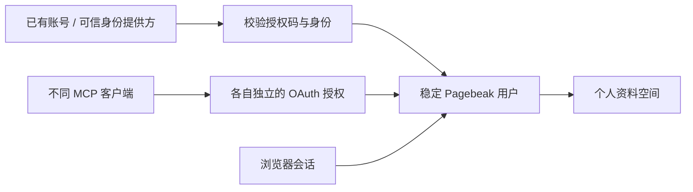

# Pagebeak 通用身份与客户端授权

日期：2026-11-05。状态：已通过本地验证并发布兼容版本；真实外部账号授权及身份必需模式尚未启用。后续线上状态见 [切换记录](通用身份线上切换-20261105.md)。

## 目标与交互

个人资料属于 Pagebeak 用户。浏览器用于保存登录会话，Agent 客户端获得独立授权。教师无需注册第二套邮箱密码；首次连接时通过已有账号完成授权，后台创建个人空间。换浏览器、换电脑或换 Agent 后，验证同一个已绑定账号即可回到原空间。

当前支持通用 OIDC 身份提供方和 WorkBuddy 官方 OAuth 账号适配器。MCP 访问仍采用标准 HTTP OAuth 授权码与 S256 PKCE。安装包、账号登录和 MCP 授权分开处理；没有 WorkBuddy 发布者配置，也能使用普通 MCP 客户端接入。

“复用客户端登录”需要客户端或账号平台开放可验证的身份。MCP 本身不传递宿主登录账号。当前实现允许使用平台已有账号授权，不读取客户端登录文件、Cookie 或令牌。原生客户端无感身份交换和 MCP Enterprise-Managed Authorization 尚未实现；不能承诺所有客户端免授权页。

## 身份与空间归属

- OIDC 根据精确的 `issuer + sub` 绑定用户，不从姓名、邮箱或客户端名称推导身份。OIDC 提供方若使用 pairwise subject，应持续使用同一 Pagebeak 应用注册；换开发者应用不能默认得到相同用户标识。
- WorkBuddy 使用服务端直接向官方 Token 端点交换得到的 `open_id`，以开发者应用 ID 作为命名空间，不假定不同应用的 `open_id` 全局相同。
- `external_identities` 将外部身份映射到现有 `users.id`；个人空间继续由服务端 `User.tenant_id` 确定。客户端不能提交 tenant ID 改变归属。
- 同一用户可以显式绑定多个外部账号。已属于另一空间的账号会返回冲突，不自动合并。
- 现有个人空间仍是一人一空间。这次没有实现组织租户的成员邀请、角色管理或跨用户共享。

## 授权实现

`identity_logins` 保存十分钟有效的登录事务，将 state、浏览器会话、提供方配置版本、发起时的用户及 MCP 待授权请求绑定。state 与 nonce 以摘要保存。OIDC 使用 S256 PKCE，校验 ID Token 签名、issuer、audience、nonce、有效期及 azp；当前支持带 kid 的 RS256 / ES256 JWKS。配置的身份端点必须为 HTTPS，禁止跟随 Token/JWKS 重定向。WorkBuddy 按其公开协议使用应用密钥在服务端交换授权码，不接受客户端自报 open_id。

成功登录会撤销登录前的浏览器会话，重新生成 Cookie 与 CSRF 密钥。回调不能跨浏览器使用，失败交换不能重放。上游账号 access token、refresh token 不落库、不提供给模型。浏览器只保存 Pagebeak 不透明会话，Agent 只接收 Pagebeak 签发的授权凭证。

MCP 每个连接分别持有访问与刷新令牌。原有刷新轮换、重放拒绝、资源地址绑定和撤销逻辑继续生效。开始页“账号与已授权助手”可查看并撤销单个客户端；撤销一个不影响其余客户端。退出网页只退出该浏览器会话，不删除资料，也不批量撤销 Agent。

原生回调支持 HTTPS、HTTP 回环地址、RFC 8252 反向域名形式的自定义协议。短协议名由 `AKB_ASSISTANT_REDIRECT_SCHEMES` 配置；兼容已有 WorkBuddy/CodeBuddy 安装。客户端实际导入配置的方式各不相同，不提供所谓所有客户端通用的一键安装格式。

## 接口

| 接口 | 用途 |
|---|---|
| `GET /v1/assistant/connection` | 获取 MCP 地址、传输与授权类型；不含用户标识和凭据 |
| `GET /v1/welcome` | 获取当前会话、可用账号入口、是否已绑定账号；WorkBuddy 助理包为可选项 |
| `POST /v1/welcome/identity/start` | 发起 signin 或显式 link，可携带待续接的 MCP 授权请求 |
| `GET /v1/welcome/identity/callback` | 交换授权码、验证身份、返回开始页继续原 MCP 授权 |
| `POST /v1/welcome/identity/logout` | 退出浏览器账号 |
| `GET /v1/welcome/connections` | 查看本人的有效 MCP 授权 |
| `POST /v1/welcome/connections/{id}/revoke` | 撤销本人的指定连接 |

所有浏览器写操作均检查 Origin、Cookie 会话与 CSRF；不能用模型猜测的姓名、邮箱、账号 ID 调用绑定。`/register` 是 MCP OAuth 动态客户端注册接口，继续保留；它与旧的教师注册 `/v1/auth/register` 不同。

## 旧空间迁移与故障恢复

旧空间不能按当前登录的外部账号静默接管。用户应先用已有授权助理的单次打开链接恢复空间，或者通过现有浏览器证明访问权，然后明确点击“绑定账号并保留资料”。绑定只增加身份映射，保留用户 ID、空间 ID、文件、目录和人工修改。

新账号的用户与空间先持久化，再开通底层文件空间。文件服务暂不可用时，重试复用已建立的同一空间及其开通记录，不因错误创建替代用户或替代空间。已有底层文件连接被停用时也不会另建一个绕过停用。

两个不同外部身份已分别形成独立空间时，本版拒绝自动合并。跨空间资料合并需要后续单独的归属验证与迁移流程。

## 配置与发布

身份提供方示例：`deploy/identity-providers.example.json`；WorkBuddy 示例：`deploy/identity-providers.workbuddy.example.json`。二者都是模板，不能作为已开通应用使用。实际配置放在服务端私有目录，应用密钥不写入前端、助理包、Skill 或聊天。

推荐发布顺序：

1. 备份数据库、文件卷和私有服务配置，保留当前发布清单。安装锁定依赖，执行迁移 `0027`。
2. 配置实际身份提供方；回调地址固定为 `<公开站点>/v1/welcome/identity/callback`。HTTPS 正式站点须启用 `AKB_COOKIE_SECURE=true`。
3. 先保持 `AKB_IDENTITY_REQUIRED=false`，让现有空间验证并绑定账号。新开始页与新版后端配套发布。
4. 使用实际平台账号核对同一人跨设备、两个实际客户端的授权和撤销。通过后设置 `AKB_IDENTITY_REQUIRED=true`。缺少提供方配置时启动会失败，不会静默回落到匿名创建。
5. 必需身份模式下，旧邮箱密码注册与登录停止提供业务服务；新的 MCP 授权必须绑定外部身份。已签发的旧 MCP 令牌不会被本次升级自动撤销，需要按迁移计划清点、重新授权或逐个撤销。

本次迁移只加表，不修改已有资料归属。破坏性 downgrade 被明确拒绝。功能回退应关闭身份必需开关、继续运行本版兼容路径；直接换回只认识 `0026` 的旧程序会被数据库版本检查阻止。数据库恢复必须按备份恢复流程单独执行，不删除身份映射表来伪装回滚。

## 验证边界

工程测试覆盖账号验证与多种 MCP 回调形态，真实浏览器验证使用合成身份服务。身份服务、账号及资料均为测试数据。WorkBuddy 适配器使用官方接口格式的模拟响应；当前没有平台开发者应用凭据，真实 WorkBuddy 账号登录为 `NOT_RUN`。其他实际 Agent 产品的原生 OAuth 兼容性、宿主无感 SSO、Windows 本地扫描及完整材料盲测也不能由这些测试推定。

初轮本地验证明细见 `work/identity-refactor-20261105/`。随后已发布 `0.13.6-identity` 兼容版本并迁移正式数据库至 `0027`，没有启用真实外部账号必需模式；切换结果、实际回退及可用性边界见上述线上记录。

## 协议依据

- [MCP HTTP Authorization](https://modelcontextprotocol.io/specification/2025-11-25/basic/authorization)
- [OpenID Connect Core](https://openid.net/specs/openid-connect-core-1_0.html)
- [OAuth 2.0 for Native Apps — RFC 8252](https://www.rfc-editor.org/rfc/rfc8252.txt)
- [WorkBuddy Open API](https://open.workbuddy.cn/docs/openapi)
- [MCP Enterprise-Managed Authorization](https://modelcontextprotocol.io/extensions/auth/enterprise-managed-authorization)：后续可选扩展，本版未实现。
